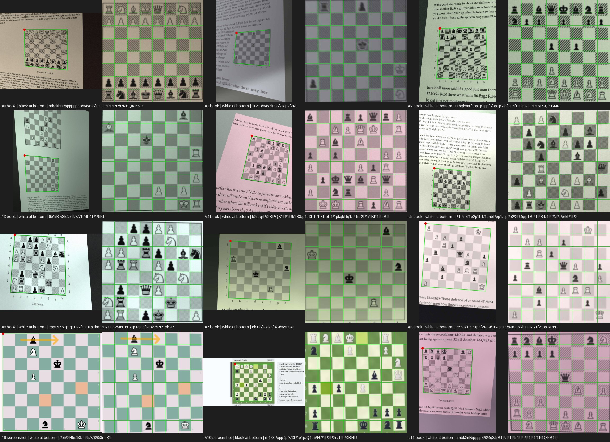

# Open Board Scanner

A small, freely licensed model that turns a screenshot or a photo of a printed
chess diagram into an editable position, entirely offline.

**[Read the short report](REPORT.md): results, and a comparison with three
other projects.** To rebuild the models, see [REPRODUCE.md](REPRODUCE.md).

**Status: two models, 3.5 MB together, that turn a photo or screenshot into a
position. Not yet in an app.** A 1.4 MB finder locates the board and a 2.0 MB
reader reads it. Given nothing but the image:

- 87 of 88 real photos the reader had never trained on were read exactly;
- 1,547 of 1,650 clean boards in 33 Lichess piece sets were read exactly.

Open risks: book typefaces and screen styles it has not seen, real
screenshots (only 28 from the chess.com app and 48 from Lichess tested, all
read correctly), and speed on a phone (not measured). The
models were trained partly on noncommercial artwork
([provenance](MODEL-LICENSE.md)), the model files are published as a
[release](https://github.com/Dash1971/open-board-scanner/releases/tag/models-v1), and inclusion in
Mobile Maia is pending a licensing review. Work is
tracked in [Issues](../../issues).

## Why

[Mobile Maia](https://github.com/Dash1971/maia-chess-android) wants a
scan-to-Board-Editor feature that works offline and fits free-software
distribution, including F-Droid. Our
[November 2026 study](https://github.com/Dash1971/mobile-maia-research/blob/main/studies/offline-board-recognition-2026-11-13/REPORT.md)
tested the available models on twelve photos and found no candidate that is
small, accurate and unrestricted at once:

| Model | File size | Exact boards / 12 | Licence |
| --- | ---: | ---: | --- |
| CrispChess | 0.84 MB | 1 (common crops) | MIT |
| Fenshot | 1.29 MB | 5 (common crops) | MIT |
| Fenify | 127.15 MB | 6 (common crops) | MIT project; weight terms unconfirmed |
| ChessQ Lite V4 INT8 | 41.37 MB | 10 (full photos) | PolyForm Noncommercial 1.0.0 |

The accurate model is large and noncommercial. The small models are free but
unreliable on printed diagrams. Classical contour detection, used to find the
board in a full photo, scored 1 to 2 of 12 in every route tested.

## Targets

| | Target |
| --- | --- |
| Total model size | 10 MB or less as INT8 ONNX; 1 MB is a stretch goal for screenshots |
| Inputs | Direct screenshots; phone photos of book diagrams; photos of a board on a monitor |
| Output | Piece placement for all 64 squares, plus which side is at the bottom |
| Runtime | ONNX Runtime on an Android CPU, no network |
| Out of scope | Photographs of physical boards and pieces |

"Accurate" will be defined against a held-out set of real photos that was not
used during development. The twelve study photos are too few, and have already
been examined, so they serve only as a first comparison with the study's table.

## Approach

1. **Synthetic training data.** Render random positions in many openly licensed
   chess fonts and piece sets, including the hatched dark squares common in
   books. Degrade the renders with perspective, page curl, uneven lighting,
   blur, halftone, paper texture, JPEG artefacts and screen moiré. Labels are
   exact and unlimited.
2. **Board localizer.** A small network that predicts the four board corners
   from a downscaled photo, replacing contour detection.
3. **Whole-board classifier.** A small network that reads the rectified board
   in one pass and outputs an 8×8 grid of 13 classes, so each square sees its
   neighbours and a slightly misaligned crop is tolerated.
4. **Orientation.** An extra output for which side is at the bottom.
5. **Real photos.** A held-out evaluation set, and fine-tuning data if the
   synthetic-only model falls short on books.

ChessQ and other restricted models are used for comparison only. Their outputs
are not used as training labels.

## Synthetic data generator

`boardgen` produces labelled images of four kinds: phone photos of printed
diagrams, direct screenshots, phone photos of a chess site on a monitor, and
phone photos of an e-book page (a PDF or reader app) on a monitor. Every sample is a
pure function of `(seed, index)`, so a dataset never has to be stored or shared.



```bash
python3.12 -m venv .venv && .venv/bin/pip install -r requirements.txt
.venv/bin/python tools/fetch_assets.py
.venv/bin/python -m boardgen sheet --seed 1 --count 12 --out docs/samples/sheet-seed1.jpg
.venv/bin/python -m boardgen dump --seed 1 --count 1000 --out data/gen/seed1
.venv/bin/python -m pytest tests
```

From Python, `boardgen.generate(seed, index)` returns the image and its labels,
and `boardgen.rectify(image, corners)` cuts out the board.

What varies:

- **Positions**: random legal play, sparse endgames, pieces scattered without
  regard to legality, the starting position and the empty board.
- **Piece artwork**: 60 sets, 26 of which look like book typefaces. Printed
  pieces are also stretched and their strokes thickened or thinned, because
  typefaces differ in proportion and weight far more than the available
  artwork does.
- **Printed diagrams**: hatched, cross-hatched, dotted, speckled, grey and
  halftone dark squares; frames; coordinates; white halos around pieces; a page of Latin or
  Cyrillic text; a second diagram nearby; print showing through the paper.
- **Screens**: board colours, last-move and check highlights,
  legal-move dots, arrows, circles, coordinates, and a generic app layout with
  player bars, clocks, an evaluation bar and a move list. A mouse pointer
  may lie over the board, and kings may carry end-of-game badges. E-book
  pages sit in a reader window, zoomed or framed, sometimes under a toolbar.
- **Camera**: perspective, tilt, page curl, uneven light, shadows, glare,
  screen moiré, blur, sensor noise, low resolution and JPEG compression.
- **Sideways photos**: about a third of book photos are turned by a quarter
  turn, as happens when the phone is held sideways.

Each sample is labelled with:

| Field | Meaning |
| --- | --- |
| `corners` | The four outer corners of the 8×8 playing area in the image, clockwise from the top-left as displayed, in pixel-centre coordinates. Frames and coordinate margins are outside. |
| `squares` | 64 piece symbols as seen in the image, row by row from the top-left; `""` is an empty square. |
| `placement` | The FEN piece-placement field of the real position. |
| `quarter_turns` | How many quarter turns counter-clockwise bring the image upright. |
| `white_at_bottom` | `false` when the upright board is shown from Black's side. |
| `kind`, `meta` | `book`, `screenshot`, `monitor` or `ebook`, and the style choices made for the sample. |

Known gaps: the degradations have not been tuned against real photos. One process generates about two full samples a second on
an Apple M4.

Piece sets and fonts are downloaded on demand and listed with their licences
in [THIRD_PARTY.md](THIRD_PARTY.md).

## Classifier: BoardNet

A narrow ResNet (1.95 million parameters) takes a 256×256 crop of the board,
in whatever orientation the photo has, and outputs:

- 13 classes for each of the 64 squares, as they appear in the image;
- how many quarter turns bring the board upright;
- which side is at the bottom of the upright board.

```bash
.venv/bin/pip install -r requirements-train.txt
.venv/bin/python -m train.make_crops --seed 1000 --count 3000 --crops 1 --out data/crops/test-v1
.venv/bin/python -m train.make_crops --seed 2 --count 24000 --holdout --out data/crops/train-v1
.venv/bin/python -m train.train --train data/crops/train-v1 --test data/crops/test-v1 --out runs/boardnet-v1
.venv/bin/python -m train.export_onnx --checkpoint runs/boardnet-v1/model.pt --data data/crops/test-v1 --out runs/boardnet-v1
```

Two versions have been trained, each for 10 epochs on an Apple M4:

| | v0 | v1 |
| --- | --- | --- |
| Generator | 13 piece sets, upright only | 18 piece sets, shape variation, sideways photos |
| Training crops | 32,000 | 48,000 |
| Outputs | squares, viewing side | squares, viewing side, quarter turns |
| Training time | 30 minutes | 41 minutes |

Two piece sets, mpchess and fantasy, are kept out of training in both
versions to measure unseen artwork.

### Synthetic test sets

Each test set is 3,000 crops from a seed never used in training. The v1 test
set is harder than the v0 one: it includes the new piece sets, shape
variation and sideways crops.

| Exact boards | v0 on v0 test | v1 on v0 test | v1 on v1 test |
| --- | ---: | ---: | ---: |
| All | 88.9% | 88.1% | 85.5% |
| Piece sets seen in training | 93.7% | 92.6% | 88.3% |
| Piece sets held out | 73.5% | 73.7% | 65.8% |
| Printed diagrams | 88.1% | 87.0% | 82.7% |
| Screenshots | 91.5% | 91.9% | 93.3% |
| Photos of a monitor | 87.5% | 86.2% | 83.8% |

On the v1 test set, v1 gets 99.54% of squares right, picks the correct
quarter turn for 99.97% of non-empty boards, and names the viewing side
correctly for 88%. Putting all three together, 76.1% of crops give the exact
position. The viewing side is the weak part: a diagram without coordinates
often does not show which way it faces.

The broader generator did not raise accuracy on the old test set, and the gap
between seen and held-out piece sets is about as wide as before.

### ONNX files (v1)

| File | Size | Exact boards (2,600 test crops) |
| --- | ---: | ---: |
| FP32 | 7.79 MB | 85.4% |
| INT8 | 2.03 MB | 85.2% |

INT8 ranges were calibrated on 400 test crops that were then left out of the
scoring. On a Mac CPU with two threads, the v0 files of the same design took
5.1 ms (FP32) and 2.1 ms (INT8) per board. Android has not been measured.

### Real photos

Twenty-four phone photos were checked by hand, in two sets of twelve, each
with six printed book pages and six photos of an e-book on a monitor.

| | Exact boards | Wrong squares | Turned upright correctly |
| --- | ---: | ---: | ---: |
| First twelve, v0 (sideways crops turned by hand) | 6 of 12 | 19 of 768 | not applicable |
| First twelve, v1 | 7 of 12 | 25 of 768 | 12 of 12 |
| Second twelve, v1 | 7 of 12 | 30 of 768 | 12 of 12 |

What this shows:

- **Rotation works.** v1 turned all 24 crops the right way, including the ten
  sideways ones, with no help.
- **Piece reading on real photos did not improve.** v1 fixed some boards and
  made others worse.
- **One typeface causes nearly all the errors.** It appears in one of the
  printed books and in the e-books, and its pawns, bishops and kings are
  confused with each other and sometimes given the wrong colour. Boards in
  the other printed typeface, and sparse positions in any typeface, were read
  without error. At the time the typeface looked like a commercial one. It
  has since been identified as Good Companion, a freeware font that Lichess
  ships as its `companion` set, and added to the generator.

These are hand checks, not measurements:

- Photos were sampled by position in the folder. The board outline came from
  plain contour detection, which worked on all 24.
- The correct positions were read by eye from the crops and have not been
  independently verified.
- v1's generator changes were chosen after seeing the errors on the first
  twelve, so only the second twelve are a fair test of v1. v0 was not run on
  the second twelve.
- The photos are private and are not published.

Those hand checks led to labelling real photos and fine-tuning on them.

### Fine-tuned on real photos (v2)

BoardNet v2 is v1 trained further on 339 labelled photos, mixed half and half
with synthetic crops so that screenshots and other artwork are not forgotten
(`python -m train.finetune`). The photos come from five sources:

| Source | Boards | v1 exact |
| --- | ---: | ---: |
| Printed book 1 (sparse endgame diagrams) | 45 | 37 |
| Printed book 2 (tall collared pawns) | 73 | 1 |
| Printed book 3 (glossy pages, glare) | 58 | 55 |
| E-book 1, photographed on a monitor | 100 | 99 |
| E-book 2, the typeface of book 2 on a monitor | 63 | 0 |
| All | 339 | 192 |

To test honestly, each source in turn was kept out of fine-tuning and then
read by a model that had never seen it:

| Held out | Boards | v1 exact | Fine-tuned, read once | Fine-tuned, read at four turns |
| --- | ---: | ---: | ---: | ---: |
| Printed book 1 | 45 | 37 | 41 | 45 |
| Printed book 3 | 58 | 55 | 58 | 58 |
| E-book 1 | 100 | 99 | 100 | 100 |
| Printed book 2 and e-book 2 together | 136 | 1 | 1 | 4 |
| Printed book 2 only | 73 | 1 | 65 | 72 |
| E-book 2 only | 63 | 0 | 58 | 62 |

What this shows:

- **Unseen books in familiar typefaces are read well.** The three sources
  with ordinary figurines came to 203 of 203 exact boards when read at four
  turns, against 191 for v1 read once.
- **An unfamiliar typeface is not learned from other books.** With both
  sources of the tall-pawn typeface held out, real photos of other books did
  nothing for it: 4 of 136.
- **Seeing a typeface once is enough to carry across media.** Trained on the
  monitor photos only, the model read 72 of 73 printed pages in that
  typeface, and 62 of 63 the other way round.
- **Reading at four turns helps.** The crop is read at each quarter turn and
  the four readings are averaged. It costs four passes, about 2 ms each for
  the INT8 file on a Mac CPU.
- **Synthetic accuracy held:** 85.1% exact boards on the v1 test set after
  fine-tuning on all 339, against 85.5% before.

The released candidate is trained on all 339 boards, so no real photo is left
to test it on; the table above is the estimate of how it behaves. Its INT8
file is 2.03 MB. Read at four turns, the INT8 and FP32 files both match the
labels on all 339 boards, which checks the export and not the accuracy.

Limits of these numbers:

- **Five sources is few.** Three of them share ordinary figurines. How many
  typefaces in circulation the model cannot read is unknown.
- **The outlines are not from a localizer.** For this test the boards were
  cut out by contour detection, corrected by hand on one photo. The finder
  built since is described under [Board finder](#board-finder).
- **Most labels were proposed by a model.** 100 boards were corrected square
  by square on the labelling page. The other 239 are readings by a model
  fine-tuned on those 100, checked by eye on contact sheets, which found
  three wrong squares. A check that starts from the model's answer can miss
  an error the model makes consistently.
- **The hand labels were not clean.** Ten wrong squares on eight of the 100
  hand-labelled boards were found by reading each board with a model that
  had not trained on it, and corrected after looking at the photo.
- **The checker was tested, on a small sample.** On 28 boards whose labels
  were already known, the contact-sheet check caught all 26 wrong squares in
  the proposals and introduced none.
- The photos are private and are not published.

### More photos, more piece sets, all four turns (v4)

BoardNet v4 is v1 trained further in two rounds (6,000 then 24,000 steps).
Three things changed from v2:

- **More photos.** A second set of 99 labelled boards from six more sources
  (e-books 3 to 8) joined the first 339. v2 read 76 of the first 92 exactly;
  nearly all its errors were on two e-books whose dark squares are a speckle
  pattern, where it saw pieces on empty squares.
- **More piece sets.** Nineteen more Lichess sets were added to the
  generator, sixteen of them under noncommercial licences (see
  [Licensing](#licensing)). Two of those, cooke and gioco, are kept out of
  training to test on.
- **Every crop at a random quarter turn.** v2 only met sideways boards in
  book photos. Reading a screenshot at four turns then showed it artwork it
  had never seen turned, and made some sets much worse (pirouetti: 45 of 50
  read once, 6 of 50 at four turns, from the given outline). Synthetic crops are now turned at
  random, like the real ones.

One fifth of the 438 labelled real boards was held out of both rounds:

| Reader | Held-out real boards read exactly (of 88) |
| --- | ---: |
| v1 (synthetic only) | 47 |
| v4, read once | 86 |
| v4, read at four turns | 87 |

This is a different test from v2's: the held-out boards come from sources the
model also trained on, so it measures new pages of known books, not new
books. On synthetic crops v4 reads 87% exactly, against 85.5% for v1.

The second test is a collection of 1,650 clean rendered boards: 50 positions
in each of 33 Lichess piece sets, on five board colourings, half of them
from Black's side. Boards read exactly from the whole image, finder included:

| Piece sets | Boards | Before the new sets | v4 |
| --- | ---: | ---: | ---: |
| The 11 already in the generator | 550 | 495 | 531 |
| The 17 added to training | 850 | 388 | 800 |
| 5 never trained on (cooke, gioco, monarchy, fantasy, mpchess) | 250 | 143 | 216 |
| All | 1,650 | 1,026 | 1,547 |

"Before" is a reader trained the same way without the added sets. Sets still
read badly: letter (17 of 50; its pieces are letters, which turning makes
ambiguous), monarchy (19, never trained on), pirouetti (33) and xkcd (39).

Limits:

- **Real screenshots have had a first check only.** 28 screenshots from the
  chess.com phone app, whose artwork was never trained on, and 48 captures
  of the Lichess analysis board were all read correctly from the whole image
  (`results/comparison/`). The rendered boards have
  no arrows, highlights, surrounding page or compression.
- **The real test is small and not independent of training sources.** 88
  boards, and only six of them from the two speckled e-books.
- **Labels for the second photo set were proposed by v2 and checked by eye**
  on contact sheets, like most of the first set.
- **v4 is trained with noncommercial artwork** and on photos of copyrighted
  pages; see [Licensing](#licensing).

Recorded metrics are in [`results/`](results).

## Board finder

BoardFinder (`train/finder.py`) finds the four corners of the board in a
whole photo or screenshot. It is the same kind of narrow ResNet as the
reader, with a small feature pyramid that brings its features back up to a
64 x 64 grid. Each corner is read as the mean position under its own
heatmap, inside the model, so the output is four points and needs no further
code. A second output says whether a whole board is in view.

| | |
| --- | --- |
| Input | The image shrunk to fit 256 x 256, with a border |
| Outputs | Four corners as fractions of the view; one "whole board in view" logit |
| Parameters | 1.33 million |
| File size | 1.43 MB as INT8 ONNX (5.3 MB as FP32) |

It looks twice: once at the whole image, then at a closer window round what
it found, which sharpens the corners. An error is the distance from a found
corner to the labelled one as a share of the board's side, taking each
board's worst corner. The reader is trained on crops that are off by up to
2.5%, so that is the tolerance.

| Test | Boards | Within 2.5% | Worst |
| --- | ---: | ---: | ---: |
| Synthetic scenes | 500 | 499 | 3.0% |
| Real photos from two sources held out of training | 158 | 158 | 1.1% |
| Second photo set, six sources never trained on | 99 | 95 | 3.2% |
| Rendered boards, 33 piece sets | 1,650 | 1,650 | |

Notes on these numbers:

- **The held-out run is not the shipped file.** It trained on 181 photos
  with two sources kept out. finder-v1 trained on all 339 photos of the
  first set, so the second photo set is its real test.
- **The labelled outlines are not exact.** On real photos they came from
  contour detection, so some of the measured error is the label's.
- **The four boards outside tolerance were still read.** With the finder's
  outline the reader got 98 of those 99 boards exactly.
- **It found boards that contour detection missed.** Of eight photos where
  the contour method gave no usable outline, the finder located seven; the
  eighth is a close-up with no whole board in it, and the finder's "board in
  view" output was 0.07.
- **Boards that fill the image needed a fix.** The first look now leaves a
  border round the image. Without it, an earlier checkpoint placed only
  1,118 of the 1,650 rendered boards within tolerance, because their corners
  sat on the very edge of the view.
- **INT8 keeps the last step in floating point.** With the heatmaps in eight
  bits the median error rose from 0.9% to 3.2%; with only the convolutions
  before them quantised it matches FP32.

Training data is 16,000 synthetic scenes from the generator
(`python -m train.make_scenes`) mixed with real photos, cut into three kinds
of view: the whole image, a closer window round the board, and windows that
cut the board or sit inside it, which teach the "board in view" output.

## From photo to position

`boardscan/` joins the two models. It needs only NumPy, OpenCV and ONNX
Runtime.

```sh
python -m boardscan --finder boardfinder-v1-int8.onnx \
    --reader boardnet-v4-int8.onnx photo.jpg
```

The two model files are in the [models release](https://github.com/Dash1971/open-board-scanner/releases/tag/models-v1).
For putting the scanner in an app, see [docs/INTEGRATION.md](docs/INTEGRATION.md).

The steps are the ones an app has to repeat:

1. Shrink the image into a 256 x 256 view with a border and run the finder.
2. Cut a closer view round the corners it gave and run the finder again.
3. Warp the board inside the final corners to 256 x 256.
4. Run the reader on that crop at each of the four quarter turns and average
   the four readings. This gives the squares, how the board is turned and
   which side is at the bottom.

That is two finder passes and four reader passes per image. On a Mac CPU the
whole chain took about 33 ms per 1280 x 960 photo; on a phone it has not been
measured. Each square comes with a confidence, so an app can mark doubtful
squares for the user to check.

Whole-chain results on real photos, with nothing but the photo given:

| Photos | Boards | Read exactly |
| --- | ---: | ---: |
| Held out of reader training | 88 | 87 |
| Second photo set, sources the finder never saw | 99 | 98 |

In the first row the finder had trained on some of the photos; in the second
the reader had trained on four fifths of them. Only 25 boards are new to
both models, and 24 of those were read exactly.

## Labelling real photos

`label/` is a page that runs on your own computer for turning a folder of
photos into labelled boards. For each photo it finds the board outline with
contour detection, cuts the board out, and shows the classifier's reading
next to it, so labelling means fixing the squares it got wrong.

```sh
pip install -r requirements.txt onnxruntime
python tools/fetch_assets.py
python -m label --photos eval/private/my-photos
```

Then open `http://127.0.0.1:8765/`. On the page you can:

- fix a square by pointing at it and pressing a piece letter;
- drag the outline's corners when the finder missed;
- turn the crop, or flip the viewing side;
- add a second board from the same photo;
- name the book a photo comes from, so whole books can be held out later.

Without a model file (`--model`, default `runs/boardnet-v1/boardnet-fp32.onnx`)
every board starts empty.

Labels are written to `eval/private/labels/<folder>.json` after every change.
Each record holds the outline, the quarter turns to upright, the board as
seen, the viewing side, the book name and the model's own reading, which is
kept so the model can be scored against the corrected labels. The format is
documented in [`label/store.py`](label/store.py).

The server listens on `127.0.0.1` only. Photos and labels stay under
`eval/private/`, which git ignores: book pages are copyrighted and are never
committed. The contour finder is a labelling aid, not the localizer.

### Checking many boards at once

Correcting every board on the page is slow. Once a model reads most boards
correctly, `label/review.py` is quicker: it draws each unlabelled board with
the proposed reading written onto it, four boards to a sheet.

```sh
python -m label.review sheets --photos eval/private/my-photos \
    --labels eval/private/labels/my-photos.json \
    --checkpoint runs/boardnet-v2/model.pt --out eval/private/review
```

Every square holding a piece gets a tag in its corner, yellow for White and
black for Black. Squares where the readings disagreed get a red frame, and
boards whose material is impossible or unusual are marked. The outcome goes
in a small JSON file (accepted boards, changed squares, unusable boards, book
names) and `python -m label.review apply` turns it into labels. Each label
records whether it was made on the page or from sheets.

## Related work

**MoveAPiece.** [MoveAPiece](https://github.com/egdels/moveapiece) (GPL-3.0) is
also training its own freely licensed model, for the same licensing reason. Its
author [describes](https://github.com/egdels/moveapiece/issues/2) a deliberately
narrow problem: photographs of a DGT Pegasus board with its original pieces,
where the board already reports which squares are occupied, so the model only
classifies the pieces on those squares. No code or weights for it were public
when checked on 22 November 2026. That is a different problem from ours:
physical pieces with occupancy known, against flat diagrams with the board
still to be found.

**DocQuadNet-256.** The same author's document scanner,
[MakeACopy](https://github.com/egdels/makeacopy), ships a self-trained
corner-detection model under Apache-2.0, with the
[training pipeline documented](https://github.com/egdels/makeacopy/blob/main/training/README.md).
It is the closest precedent for our board localizer:

- MobileNetV3 backbone with a light feature pyramid, 256×256 input.
- Two outputs at 64×64: four corner heatmaps and a segmentation mask.
  Confidence combines the heatmap peak with corner-to-mask agreement.
- The predicted quad is snapped to image gradients at full resolution.
- A few fixed test-time rotations when the first pass is not confident.
- The shipped model file is 13.4 MB.
- On-device, ONNX Runtime's CPU provider with two threads was the fastest
  option they measured.

Their data notes also apply here: keep near-duplicate frames out of separate
splits, and replace backgrounds to stop the model learning the table.

## Licensing

Copyright (c) 2026 Dash. Code and documentation in this repository are
licensed under the [GNU Affero General Public License v3.0 only](LICENSE)
(`AGPL-3.0-only`), the same licence as Mobile Maia. Contributions are accepted
under the same licence.

Trained models are under the same licence. What they were trained on,
including artwork licensed for noncommercial use, is stated in
[MODEL-LICENSE.md](MODEL-LICENSE.md).

Every font and piece set used to generate training data is listed with its
source and terms in [THIRD_PARTY.md](THIRD_PARTY.md), which also records the
sets that were left out. Private evaluation photos of copyrighted books are
kept in `eval/private/` and are not committed.

Sixteen of the piece sets are licensed for noncommercial use only (CC
BY-NC-SA). They were added because they include some of the most used
pieces on Lichess, and a model that has not seen them reads those
screenshots badly. We do not treat the trained model as a derivative of that
artwork, but we state the provenance so that others can judge for
themselves. The manifest marks these sets, and
`python -m train.make_crops --sets open` generates training data without
them, so a model trained only on openly licensed artwork can be made from
this repository.

BoardNet v2 and v4 were fine-tuned on photographs of diagrams in copyrighted books
and e-books. The photographs are not distributed, and the model outputs only
piece positions. This too is stated as provenance.
