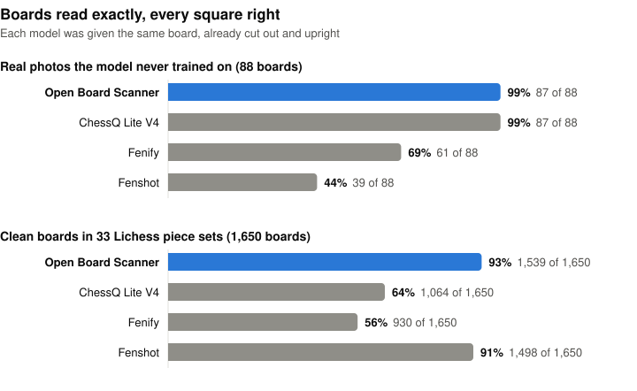
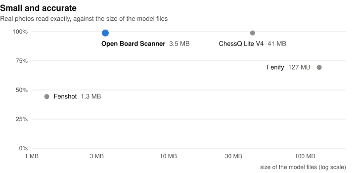

# Open Board Scanner: a 3.5 MB model that reads chess diagrams

**23 November 2026 · follow-up to the
[Mobile Maia offline board recognition study](https://github.com/Dash1971/mobile-maia-research/blob/main/studies/offline-board-recognition-2026-11-13/REPORT.md)**

Two small models turn a photo of a book diagram, or a board on a screen, into
a position. We ran them against three other projects on the same boards.

<picture>
  <source media="(prefers-color-scheme: dark)" srcset="docs/report/exact-boards-dark.svg">
  
</picture>

## Comparison

| Model | Size | Licence | Photos of books and monitors | Screen piece sets | Time per board | Strongest at |
| --- | ---: | --- | ---: | ---: | ---: | --- |
| **Open Board Scanner** | **3.5 MB** | AGPL-3.0 ¹ | **99%** | **93%** | **6 ms** | Both jobs in one small, fast model. Finds the board and turns it upright itself. |
| [ChessQ Lite V4](https://chessq.org/about) | 41 MB | Noncommercial | **99%** | 64% | 430 ms | Photos of books it has never seen. |
| [Fenshot](https://github.com/scoriiu/fenshot) | 1.3 MB | MIT | 44% | 91% | 7 ms | Screen boards, at the smallest size and with open terms. |
| [Fenify](https://github.com/notnil/fenify) | 127 MB | MIT | 69% | 56% | 265 ms | Open terms on photos. |

¹ Trained partly on artwork licensed for noncommercial use; see
[model licence and provenance](MODEL-LICENSE.md).

Photos: 88 real photos, every square right. Screen piece sets: 1,650 clean
boards, 50 in each of 33 Lichess sets. Time: one board on a Mac CPU with two
threads.

<picture>
  <source media="(prefers-color-scheme: dark)" srcset="docs/report/size-accuracy-dark.svg">
  
</picture>

## Why we built it, and what changed

We decided to try our own model to get round the licensing and size problems
the earlier study found: the accurate model was large and noncommercial, and
the small open ones were not accurate enough.

We could not get the performance we needed without noncommercial piece sets,
so the models are trained partly on them. They are licensed under AGPL-3.0,
and we state plainly what they were trained on
([details](MODEL-LICENSE.md)). What we did achieve is a high level of
performance from a relatively small model.

**Inclusion in Mobile Maia is pending while we review the licensing
implications.**

## Read these numbers with care

- **Our model had a head start on the photos.** It trained on other pages of
  the same books. The other three had never seen these books.
- **It had a head start on the screen boards too.** It trained on the artwork
  of 28 of the 33 piece sets, though not on these images. On the five sets it
  never saw, it read 213 of 250; Fenshot 200, ChessQ 164, Fenify 155.
- **Every model got the board already cut out.** From the whole photo, ours
  read 87 of 88. ChessQ read 72 of 88 with the photo resized the way the
  earlier study did it; its own app may prepare photos differently.
- **The test is small.** 88 photos from eleven sources.
- **Real screenshots: a first check only.** From the whole screenshot, ours
  read 28 of 28 from the chess.com phone app (artwork it never trained on;
  ChessQ 26) and 48 of 48 from the Lichess analysis board (ChessQ 34). Both
  sets use each site's common pieces and are small.
- **Three projects from the earlier study were not re-run:** CrispChess, Chess
  Acuity and Chess diagram to FEN. There they read 1, 1 and 6 of 12 photos.

## Where to look

- [Models release](https://github.com/Dash1971/open-board-scanner/releases/tag/models-v1): the two model files, 3.5 MB together.
- [README](README.md): how the models were built and every result.
- [`results/comparison/`](results/comparison): the numbers behind this page,
  by source and piece set, and the Lichess screenshot check.
- [REPRODUCE.md](REPRODUCE.md): every command and seed, and what cannot be
  reproduced without our private photos.
- [`tools/compare_models.py`](tools/compare_models.py): the test itself. The
  other projects' model files are the versions pinned in the earlier study.
